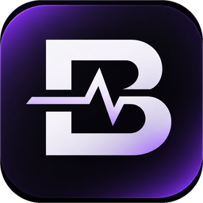
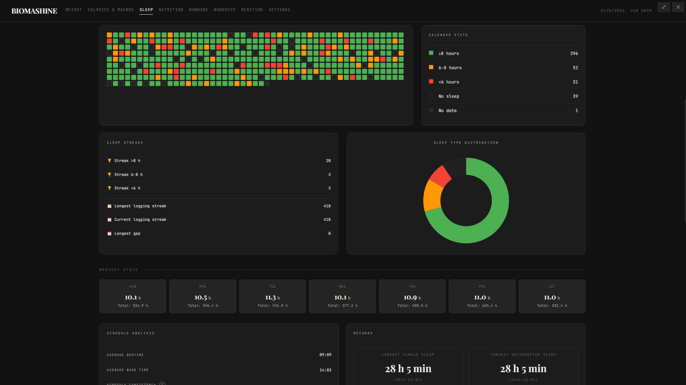

  

<h1 align="center">BIOMASHINE</h1>

Eine Betriebsumgebung für persönliche Erfassung

  <a href="README.md">English</a> / <a href="README.ru.md">Русский</a> / <a href="README.es.md">Español</a> / <b>Deutsch</b>

  
  
  
  
  

  <a href="https://github.com/chetsCMD/BIOMASHINE/releases">Herunterladen</a> ·
  <a href="https://github.com/chetsCMD/BIOMASHINE/issues">Problem melden</a> ·
  <a href="https://boosty.to/chetscmd">Projekt unterstützen</a>

---

## Was ist BIOMASHINE

BIOMASHINE ist eine Betriebsumgebung für persönliche Erfassung.

Das Leben beschränkt sich nicht auf Gesundheit. Es umfasst den körperlichen und psychischen Zustand, Finanzen, intellektuelle Tätigkeit, die Beobachtung der Umgebung – und vieles mehr. BIOMASHINE schreibt nicht vor, was genau erfasst werden soll und wie man leben sollte. Der Nutzer entscheidet selbst, welche Aufzeichnungen er braucht und welche Bedeutung sie haben.

Stellen Sie sich einen Papier-Planer-Organizer vor: Er hat einen Einband, eine Ringmechanik, Papier und Trenner. Sie fügen selbst neue Abschnitte ein, entfernen unnötige, ordnen Seiten um, erstellen eigene und schreiben hinein, was Sie möchten. Der Hersteller des Organizers entscheidet nicht für Sie, was in Ihrem Tagebuch stehen soll.

BIOMASHINE möchte dieselbe Freiheit in digitaler Form bieten. Die Anwendung stellt bereit:

- einen Mechanismus zur Datenspeicherung;
- einen Mechanismus zu deren Anzeige und Verarbeitung;
- einen Mechanismus zur Erweiterung durch Nutzermodule;
- eine Schnittstelle zur Interaktion;
- ein System zur Verwaltung von Modulen.

Und der Nutzer bestimmt, **was genau erfasst wird**.

## Warum BIOMASHINE

- **Ihres.** Die Daten verlassen den Computer nicht. Keine Telemetrie, kein Synchronisierungsdienst, keine Registrierung.
- **Bis auf das Pixel anpassbar.** Im Code ist nichts fest verdrahtet: weder Gestaltung noch Texte noch Koeffizienten. Sprache, Farben, Größen, Schriftarten, Formeln und Konstanten liegen in Einstellungen und Konfigurationsdateien, die in der Anwendung selbst oder manuell bearbeitet werden können.
- **Modular.** Jede Seite ist ein Modul. Blenden Sie Unnötiges aus, fügen Sie Eigenes hinzu oder beschreiben Sie die benötigte Seite einem KI-Assistenten und legen Sie das Ergebnis in den Modulordner.
- **Offen.** Freie Software unter der GPL-Lizenz.

## Der Nutzer steuert die Anwendung

Die Grundidee von BIOMASHINE ist: **Der Mensch steuert das Programm, nicht das Programm den Menschen.** Dies ist nicht nur ein fertiger Satz von Seiten, der „wie vorgesehen“ verwendet werden muss. Der Nutzer kann die Umgebung nach seinen Bedürfnissen gestalten:

- eigene Module für die benötigten Arten der Erfassung erstellen;
- Module aktivieren und ausblenden und so die Zusammensetzung der Anwendung steuern;
- Plugins erstellen und das Erscheinungsbild der Oberfläche ändern – einschließlich der Entwicklung eigener Themes auf Basis des Stil- und Plugin-Mechanismus;
- die Oberfläche in jede Sprache übersetzen: Die Anwendung bietet Sprachdateien und die Möglichkeit, eigene Übersetzungen hinzuzufügen.

## Welche Basisseiten verfügbar sind

In der aktuellen Version gibt es mehrere fertige Beispielseiten:

- **Gewicht** – Messungen und Ziele.
- **Schlaf** – Schlaftagebuch und Zeitplan.
- **Ernährung** – Aufzeichnungen über Mahlzeiten.
- **Kalorien & Makros** – Berechnung von Kalorien- und Makronährstoffrichtwerten auf Basis der Profildaten.
- **Laufen** – Läufe, Ziele und Statistiken.
- **Training** – Einheiten und Trainingsvorlagen.
- **Reaktion** – Reaktionsgeschwindigkeitstest und Ergebnisverlauf.

## Navigation

- **Leiste und Modul-Hub.** Heften Sie die wichtigsten Module an die obere Leiste; die übrigen warten im Hub: einer Kartenseite mit Suche, Kategorien und Anheft-Schaltflächen. Lieber eine Seitenleiste? Wechseln Sie zu einem vertikalen Layout mit einklappbaren Kategorien.
- **Schnellsprung.** `Ctrl+P` (`Cmd+P` unter macOS) öffnet jedes Modul oder jeden Einstellungsbereich und funktioniert mit jedem Tastaturlayout.
- **Eigene Tastenkürzel.** Jede Tastenkombination kann in den Einstellungen neu zugewiesen werden.
- **Vollbild.** `F11` aktiviert es, und die Fenstersteuerung bleibt erreichbar.
- **Sitzungswiederherstellung.** Beim Beenden kann die Anwendung anbieten, das geöffnete Modul, Feldwerte und die Scrollposition zu merken und Sie beim nächsten Start genau zu diesem Bildschirm zurückzubringen.

# Hauptfunktion des Programms
**Modulare Architektur**. Sie bestimmen selbst, was Sie in BIOMASHINE sehen möchten.

Wenn Sie Entwickler sind, steht Ihnen die [Dokumentation](../.github/README.de.md#dokumentation) zur Verfügung.

Aber wenn Sie nicht mit Code arbeiten können – kein Problem. Es gibt eine [Dokumentation für Ihren KI-Agenten](../docs/de/ai). Geben Sie ihm die Datei und beschreiben Sie, was Sie sehen möchten; er führt Sie vollständig selbstständig von der Idee bis zum fertigen Modul.

## Machen Sie es zu Ihrem

- **Sprachen.** Russisch, Englisch, Spanisch und Deutsch sind integriert. Exportieren Sie in den Einstellungen eine Übersetzungsvorlage, übersetzen Sie sie, legen Sie die Datei in den Sprachordner, und Ihre Sprache erscheint in der Liste.
- **Design.** Helles und dunkles Theme, und dahinter ein Design-Editor: Jede Farbe, Größe, Abstand, Radius, Schriftart und Animationsdauer ist ein Token, das für die gesamte Anwendung oder für ein einzelnes Modul mit Live-Vorschau geändert werden kann. Schreiben Sie eigenes CSS für die gesamte Anwendung oder ein einzelnes Modul, importieren und exportieren Sie fertige Designs und ordnen Sie Plugins in der gewünschten Reihenfolge an.
- **Konfigurationseditor.** Ändern Sie beliebige JSON-Konfigurationen (Koeffizienten, Farben, Grenzwerte) direkt in der Anwendung. Änderungen werden sofort angewendet, und gespeichert werden nur Ihre Abweichungen von den Standardwerten.
- **Zeitzone.** Wählen Sie, in welcher Zeitzone Datum und Uhrzeit aufgezeichnet werden.
- **Profile.** Halten Sie mehrere unabhängige Bereiche, zum Beispiel „echtes Leben“, „Experiment“ und „Sandbox“. Jedes Profil hat seine eigene Datenbank; erstellen, duplizieren, benennen Sie sie um, löschen und wechseln Sie sie in den Einstellungen.

## Prinzipien

- **Der Nutzer bestimmt die Regeln.** Die Anwendung hilft beim Sammeln und Einordnen von Informationen, bewertet den Menschen aber nicht und schreibt ihm keine Ziele vor.
- **Daten bleiben lokal.** BIOMASHINE arbeitet mit einer SQLite-Datenbank auf dem Gerät; ein Cloud-Konto und eine Internetverbindung sind für das Führen von Aufzeichnungen nicht erforderlich.
- **Ein persönliches System, kein Unternehmensdienst.** Es ist ein Werkzeug „von Menschen für Menschen“, geschaffen für die alltäglichen Aufgaben eines konkreten Menschen – des Nutzers.
- **Freiheit statt eines einzigen Szenarios.** Fertige Seiten sind eine Grundlage, die der Nutzer durch eigene Module, Themes und Übersetzungen ergänzen kann.
- **Erfassung für sich selbst.** Aufzeichnungen sind nicht dazu da, jemandem etwas zu beweisen. Ihren Wert bestimmt der Mensch selbst.

## Ihre Daten sind sicher

- **Nur lokal.** Eine SQLite-Datenbank pro Profil, kein Netzwerkzugriff.
- **Passwortschutz.** Optionaler Login und optionales Passwort, gespeichert als scrypt-Hash mit Salt.
- **Papierkorb.** Machen Sie die letzten zehn Vorgänge direkt aus den Einstellungen rückgängig.
- **Export.** Speichern Sie jederzeit alles als JSON oder CSV.
- **Benachrichtigungen.** Module können Systembenachrichtigungen planen, und Sie können sie für jedes Modul deaktivieren.
- **Isolation.** Jedes Modul läuft in einem eigenen isolierten Frame und kann nur deklarierte Kanäle verwenden.

## Herunterladen und installieren

Die neueste Build-Version finden Sie auf der [Release-Seite](https://github.com/chetsCMD/BIOMASHINE/releases).

| System | Datei | Hinweise |
|---|---|---|
| Windows | `.exe` (portabel) oder `.zip` | Es muss nichts installiert werden. Die portable Version speichert Daten im Ordner `BIOMASHINE-data` neben dem Programm und kann daher auf einem USB-Stick mitgeführt werden. |
| Linux | `.AppImage` | `chmod +x` und starten. Benötigt `libfuse2`. |
| macOS | `.zip` | Nicht signiert: Beim ersten Start mit der rechten Maustaste auf die App klicken und „Öffnen“ wählen. |

## Aus dem Quellcode bauen

Erforderlich ist Node.js 22 oder neuer.

    npm install
    npm start          # Anwendung starten
    npm run dist       # für das aktuelle Betriebssystem bauen

Native Module müssen auf dem Betriebssystem gebaut werden, für das die Build-Version bestimmt ist. Im Repository gibt es einen funktionierenden GitHub-Actions-Workflow, der Pakete für Windows, Linux und macOS baut.

## Dokumentation

- [Projektkarte: Architektur, IPC-Kanäle, Datenschicht](../docs/de/Developers/Project%20Map.md)
- [Module: Manifest, SDK, Speicher, Gestaltung](../docs/de/Developers/Modules.md)
- [Designsystem: Tokens, Werkzeug, Editor](../docs/de/Developers/Design.md)
- [Leitfaden für KI-Assistenten: Erstellen eines Moduls](../docs/de/ai/MODULE_GUIDE.md)
- [Leitfaden für KI-Assistenten: Erstellen eines Plugins](../docs/de/ai/PLUGIN_GUIDE.md)

## Projekt unterstützen

BIOMASHINE ist kostenlos und wird von einer Person entwickelt. Wenn es Ihnen nützlich ist, können Sie den [Autor unterstützen](https://boosty.to/chetscmd) oder dem Repository einen Stern geben.

## Lizenz

BIOMASHINE ist freie Software unter der GNU General Public License v3.0 mit einer zusätzlichen Bedingung zur Namensnennung (Abschnitt 7b). Der vollständige Text befindet sich in der Datei `LICENSE`.
