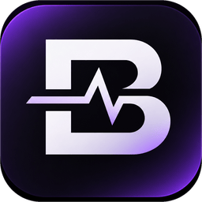
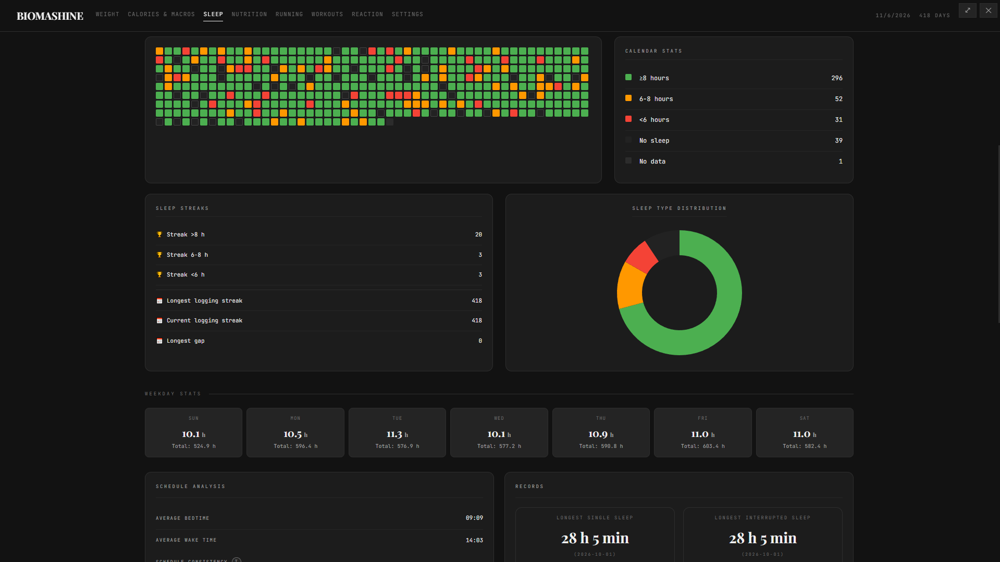

<p align="center">
  <a href="https://github.com/chetsCMD/BIOMASHINE/releases">
    
  </a>
</p>

<h1 align="center">BIOMASHINE</h1>

<p align="center">Entorno operativo para el registro personal</p>

<p align="center">
  <a href="README.md">English</a> / <a href="README.ru.md">Русский</a> / <a href="README.es.md">Español</a>
</p>

<p align="center">
  
  
  
  
</p>

<p align="center">
  <a href="https://github.com/chetsCMD/BIOMASHINE/releases">Descargar</a> ·
  <a href="https://github.com/chetsCMD/BIOMASHINE/issues">Informar de un problema</a> ·
  <a href="https://boosty.to/chetscmd">Apoyar el proyecto</a>
</p>

<p align="center">
  <a href="https://github.com/chetsCMD/BIOMASHINE/blob/main/docs/es/ROADMAP.es.md">ROADMAP</a>
</p>

---

## Qué es BIOMASHINE

BIOMASHINE es un entorno operativo para el registro personal.

La vida no se reduce a la salud. Es estado físico y psicológico, finanzas, actividad intelectual, observación del entorno — y mucho más. BIOMASHINE no prescribe qué exactamente hay que registrar ni cómo debería vivirse. El usuario elige por sí mismo qué registros necesita y qué significado tienen.

Imagine una agenda-organizador de papel: tiene tapa, mecanismo de anillas, papel y separadores. Usted mismo inserta nuevas secciones, retira las innecesarias, reordena las páginas, crea las propias y anota en ellas lo que quiera. El fabricante del organizador no decide por usted qué debe haber en su diario.

BIOMASHINE busca ofrecer la misma libertad en formato digital. La aplicación proporciona:

- mecanismo de almacenamiento de datos;
- mecanismo de visualización y procesamiento;
- mecanismo de extensión con módulos de usuario;
- interfaz de interacción;
- sistema de gestión de módulos.

Y el usuario define **qué exactamente registrar**.

## El usuario controla la aplicación

La idea principal de BIOMASHINE es que **la persona controla el programa, y no el programa a la persona**. No es solo un conjunto listo de páginas que haya que usar «como está previsto». El usuario puede formar el entorno a su medida:

- crear sus propios módulos para los tipos de registro que necesite;
- conectar y ocultar módulos, gestionando la composición de la aplicación;
- crear plugins y cambiar la apariencia de la interfaz — incluso desarrollar temas propios basados en el mecanismo de estilos y plugins;
- traducir la interfaz a cualquier idioma: en la aplicación hay archivos de idioma y la posibilidad de añadir traducciones propias.

Las secciones integradas son solo un punto de partida. Muestran cómo está organizado el entorno, pero no limitan su finalidad.

## Qué páginas básicas hay disponibles

En la versión actual hay varios ejemplos listos de páginas:

- **Peso** — mediciones y objetivos.
- **Sueño** — diario de sueño y horario.
- **Nutrición** — registros de comidas.
- **KBJU (calorías, proteínas, grasas y carbohidratos)** — cálculo de referencias de calorías y macronutrientes a partir de los datos del perfil.
- **Carrera** — carreras, objetivos y estadísticas.
- **Entrenamientos** — sesiones y plantillas de entrenamiento.
- **Reacción** — prueba de velocidad de reacción e historial de resultados.

[](media/sleep.png)

Esta no es una lista completa de lo que debería ser BIOMASHINE, ni una recomendación de llevar precisamente esos registros. La composición de la aplicación se puede y **se debe** cambiar y ampliar según las propias tareas.
> Puede seguir el desarrollo del proyecto y la creación de nuevas páginas en la [hoja de ruta](https://github.com/chetsCMD/BIOMASHINE/blob/main/docs/es/ROADMAP.es.md)

# Función principal del programa
**Arquitectura modular**. Usted mismo define qué quiere ver en BIOMASHINE.

Si es desarrollador, tiene disponible la [documentación](https://github.com/chetsCMD/BIOMASHINE/blob/main/.github/README.es.md#documentación-para-desarrolladores-y-creadores-de-extensiones).

Pero si no sabe trabajar con código, no hay problema. Hay [documentación disponible para su agente de IA](https://github.com/chetsCMD/BIOMASHINE/blob/main/docs/es/ai). Entréguele el archivo y describa qué quiere ver, y él le guiará de forma totalmente autónoma desde la idea hasta un módulo terminado.

> [En el futuro](https://github.com/chetsCMD/BIOMASHINE/blob/main/docs/es/ROADMAP.es.md) está previsto añadir la creación de módulos a partir de bloques listos.

## Principios

- **El usuario establece las reglas.** La aplicación ayuda a recopilar y comprender información, pero no evalúa a la persona ni le impone objetivos.
- **Los datos permanecen locales.** BIOMASHINE trabaja con una base SQLite en el dispositivo; no hacen falta una cuenta en la nube ni conexión a internet para llevar registros.
- **Sistema personal, no servicio corporativo.** Es una herramienta «de personas a personas», creada para las tareas cotidianas de una persona concreta: el usuario.
- **Libertad en lugar de un único escenario.** Las páginas listas son una base que el usuario puede complementar con sus propios módulos, temas y traducciones.
- **Registro para uno mismo.** Los registros no sirven para demostrar algo a alguien. Su valor lo determina la propia persona.

## Descarga

Las compilaciones listas se publican en la página [Releases](https://github.com/chetsCMD/BIOMASHINE/releases). La versión de escritorio se compila para Windows, Linux (AppImage) y macOS (`.zip`).

### Windows: instalador y versión portátil

Para Windows hay tres formatos:

- **Instalador (NSIS, `BIOMASHINE-<versión>-setup.exe`)** — instalación normal para el usuario actual. Permite elegir la carpeta de instalación y crea un acceso directo en el escritorio. **Los datos de la aplicación se almacenan en `%APPDATA%\BIOMASHINE`** y no se eliminan al desinstalar el programa.
- **Versión portátil (`.exe`)** — no requiere instalación. **Los datos se almacenan junto al archivo ejecutable del programa**, lo que permite llevar la aplicación en una unidad flash.
- **Archivo ZIP** — contiene los mismos archivos que la versión portátil, para colocarlos manualmente.

La aplicación no requiere una cuenta en la nube. Como la base está localmente, al trasladarla a otro dispositivo hay que moverla por separado o usar la exportación de datos en los ajustes.

## Ejecución desde el código fuente

Se requieren Node.js versión 22 o superior y npm.

```bash
npm install
npm start
```

Preparar el distributivo para el sistema operativo actual:

```bash
npm run dist
```

Debe compilarse en el mismo sistema operativo para el que está destinado el distributivo: `better-sqlite3` contiene un módulo nativo. La preparación de los recursos de la aplicación se inicia automáticamente con los comandos `npm start` y `npm run dist`.

## Datos y seguridad

- En los ajustes se puede establecer un usuario y una contraseña para abrir el programa. No hay posibilidad de restablecer la contraseña si se pierde.
- Los datos de la aplicación se almacenan localmente en una base SQLite en el directorio de datos de la aplicación. En la versión instalada de Windows, en `%APPDATA%\BIOMASHINE`; en la portátil, junto al programa.
- En los ajustes están disponibles la exportación a JSON y CSV.
- Las páginas de la aplicación funcionan como módulos. Los módulos de usuario y las configuraciones están previstos por la arquitectura del proyecto.
- El almacenamiento local por sí mismo no es una copia de seguridad. Se recomienda guardar periódicamente la exportación y conservarla en un lugar seguro.

## Atajos de teclado

- `Ctrl+P` (en macOS, `Cmd+P`) — salto rápido a una sección o a los ajustes.
- `F11` — modo de pantalla completa.

## Documentación para desarrolladores y creadores de extensiones

- [`docs/Project Map.md`](https://github.com/chetsCMD/BIOMASHINE/blob/main/docs/es/Developers/Project%20Map.md) — estructura y mapa del proyecto.
- [`docs/Modules.md`](https://github.com/chetsCMD/BIOMASHINE/blob/main/docs/es/Developers/Modules.md) — arquitectura de módulos y SDK interno.
- [`docs/ai/`](https://github.com/chetsCMD/BIOMASHINE/tree/main/docs/es/ai) — guías y ejemplos para módulos, plugins y configuraciones.

## Participación y comentarios

¿Ha encontrado un error o quiere proponer una mejora? Cree un [issue](https://github.com/chetsCMD/BIOMASHINE/issues). Antes de enviarlo, compruebe si ya existe una discusión similar.
El proyecto tiene la filosofía «De personas a personas», así que cree libremente actualizaciones y mejoras. También: sus propios módulos, temas, traducción a otros idiomas.
La versión `1.0.0` es un ejemplo demostrativo de qué es este proyecto, no una versión final. Siga el desarrollo del proyecto/las ideas para ayudar a desarrollar el proyecto en la [ROADMAP](https://github.com/chetsCMD/BIOMASHINE/blob/main/docs/es/ROADMAP.es.md)
