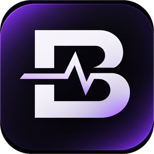
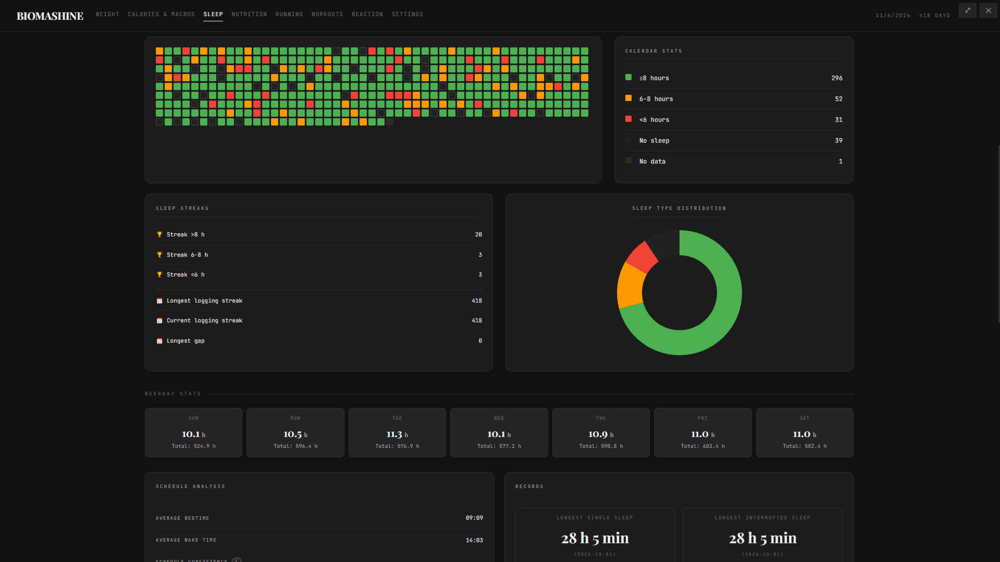

  

<h1 align="center">BIOMASHINE</h1>

Entorno operativo para el registro personal

  <a href="README.md">English</a> / <a href="README.ru.md">Русский</a> / <b>Español</b> / <a href="README.de.md">Deutsch</a>

  
  
  
  
  

  <a href="https://github.com/chetsCMD/BIOMASHINE/releases">Descargar</a> ·
  <a href="https://github.com/chetsCMD/BIOMASHINE/issues">Informar de un problema</a> ·
  <a href="https://boosty.to/chetscmd">Apoyar el proyecto</a>

---

## Qué es BIOMASHINE

BIOMASHINE es un entorno operativo para el registro personal.

La vida no se reduce a la salud. Es estado físico y psicológico, finanzas, actividad intelectual, observación del entorno — y mucho más. BIOMASHINE no prescribe qué debe registrarse ni cómo se debe vivir. El usuario elige qué registros necesita y qué significado tienen.

Imagine una agenda-organizador de papel: tiene cubierta, mecanismo de anillas, papel y separadores. Usted mismo inserta nuevas secciones, quita las innecesarias, reordena páginas, crea las propias y escribe en ellas lo que quiera. El fabricante del organizador no decide por usted qué debe haber en su diario.

BIOMASHINE busca ofrecer la misma libertad en formato digital. La aplicación proporciona:

- un mecanismo de almacenamiento de datos;
- un mecanismo de visualización y procesamiento de esos datos;
- un mecanismo de extensión con módulos de usuario;
- una interfaz de interacción;
- un sistema de gestión de módulos.

Y el usuario determina **qué registrar exactamente**.

## Por qué BIOMASHINE

- **Suyo.** Los datos no salen del ordenador. Sin telemetría, sin servicio de sincronización, sin registro.
- **Personalizable hasta el píxel.** Nada está codificado de forma fija: ni la apariencia, ni los textos, ni los coeficientes. Idioma, colores, tamaños, fuentes, fórmulas y constantes están en ajustes y archivos de configuración que se pueden editar en la propia aplicación o manualmente.
- **Modular.** Cada página es un módulo. Oculte lo que no necesite, añada lo suyo o describa la página que necesita a un asistente de IA y coloque el resultado en la carpeta de módulos.
- **Abierto.** Software libre bajo licencia GPL.

## El usuario controla la aplicación

La idea principal de BIOMASHINE es que **la persona controla el programa, no el programa a la persona**. No es solo un conjunto de páginas listo para usar «como se pretende». El usuario puede formar el entorno a su medida:

- crear módulos propios para los tipos de registro que necesite;
- activar y ocultar módulos, controlando la composición de la aplicación;
- crear plugins y cambiar la apariencia de la interfaz, incluido el desarrollo de temas propios basados en el mecanismo de estilos y plugins;
- traducir la interfaz a cualquier idioma: la aplicación incluye archivos de idioma y la posibilidad de añadir traducciones propias.

## Qué páginas básicas hay disponibles

En la versión actual hay varias páginas de ejemplo ya preparadas:

- **Peso** — mediciones y objetivos.
- **Sueño** — diario de sueño y horario.
- **Nutrición** — registros de comidas.
- **Calorías y macros** — cálculo de objetivos de calorías y macronutrientes a partir de los datos del perfil.
- **Carrera** — carreras, objetivos y estadísticas.
- **Entrenamientos** — sesiones y plantillas de entrenamiento.
- **Reacción** — test de velocidad de reacción e historial de resultados.

## Navegación

- **Panel y hub de módulos.** Fije los módulos más necesarios en el panel superior; los demás esperan en el hub: una página de tarjetas con búsqueda, categorías y botones de fijación. ¿Prefiere un menú lateral? Cambie a una disposición vertical con categorías plegables.
- **Salto rápido.** `Ctrl+P` (`Cmd+P` en macOS) abre cualquier módulo o sección de ajustes y funciona con cualquier distribución de teclado.
- **Atajos propios.** Cualquier combinación se puede reasignar en los ajustes.
- **Pantalla completa.** `F11` la activa, y los botones de control de la ventana quedan a mano.
- **Restauración de sesión.** Al salir, la aplicación puede ofrecer recordar el módulo abierto, los valores de los campos y la posición de desplazamiento, y devolverle exactamente a esa pantalla en el siguiente inicio.

# Función principal del programa
**Arquitectura modular**. Usted mismo determina qué quiere ver en BIOMASHINE.

Si es desarrollador, tiene disponible la [documentación](../.github/README.es.md#documentación).

Pero si no sabe trabajar con código, no hay problema. Hay [documentación disponible para su agente de IA](../docs/es/ai). Entréguele el archivo y describa lo que quiere ver, y le guiará de forma totalmente autónoma desde la idea hasta un módulo terminado.

## Hágalo a su medida

- **Idiomas.** Integrados ruso, inglés, español y alemán. Exporte una plantilla de traducción en los ajustes, tradúzcala, coloque el archivo en la carpeta de idiomas y su idioma aparecerá en la lista.
- **Diseño.** Temas claro y oscuro, y detrás un editor de diseño: cada color, tamaño, espaciado, radio, fuente y duración de animación es un token que se puede cambiar para toda la aplicación o para un módulo con vista previa en vivo. Escriba CSS propio para toda la aplicación o para un módulo, importe y exporte diseños listos y ordene los plugins como necesite.
- **Editor de configuración.** Cambie cualquier configuración JSON (coeficientes, colores, límites) directamente en la aplicación. Los cambios se aplican de inmediato y solo se guardan sus diferencias respecto a los valores predeterminados.
- **Zona horaria.** Elija en qué zona horaria se registran fechas y horas.
- **Perfiles.** Mantenga varios espacios independientes, por ejemplo «vida real», «experimento» y «sandbox». Cada perfil tiene su propia base de datos; créelos, duplíquelos, renómbrelos, elimínelos y cámbielos en los ajustes.

## Principios

- **El usuario establece las reglas.** La aplicación ayuda a recopilar y comprender información, pero no evalúa a la persona ni le impone objetivos.
- **Los datos permanecen locales.** BIOMASHINE trabaja con una base de datos SQLite en el dispositivo; no se necesita una cuenta en la nube ni conexión a internet para llevar registros.
- **Un sistema personal, no un servicio corporativo.** Es una herramienta «de personas a personas», creada para las tareas cotidianas de una persona concreta: el usuario.
- **Libertad en lugar de un único escenario.** Las páginas listas son una base que el usuario puede complementar con módulos, temas y traducciones propios.
- **Registro para uno mismo.** Los registros no existen para demostrar algo a alguien. Su valor lo determina la propia persona.

## Sus datos están seguros

- **Solo local.** Una base de datos SQLite por perfil, sin acceso a la red.
- **Protección con contraseña.** Inicio de sesión y contraseña opcionales, almacenados como hash scrypt con sal.
- **Papelera.** Deshaga las últimas diez operaciones directamente desde los ajustes.
- **Exportación.** Guarde todo en JSON o CSV en cualquier momento.
- **Notificaciones.** Los módulos pueden programar notificaciones del sistema, y usted puede desactivarlas para cada módulo.
- **Aislamiento.** Cada módulo se ejecuta en su propio marco aislado y solo puede usar los canales declarados.

## Descargar e instalar

Descargue la compilación más reciente en la [página de releases](https://github.com/chetsCMD/BIOMASHINE/releases).

| Sistema | Archivo | Notas |
|---|---|---|
| Windows | `.exe` (portátil) o `.zip` | No hay que instalar nada. La versión portátil guarda los datos en la carpeta `BIOMASHINE-data` junto al programa, por lo que se puede llevar en una memoria USB. |
| Linux | `.AppImage` | `chmod +x` y ejecutar. Requiere `libfuse2`. |
| macOS | `.zip` | Sin firma: en el primer inicio, haga clic derecho en la aplicación y elija «Abrir». |

## Compilar desde el código fuente

Requiere Node.js 22 o superior.

    npm install
    npm start          # iniciar la aplicación
    npm run dist       # compilar para el sistema operativo actual

Los módulos nativos deben compilarse en el sistema operativo para el que se realiza la compilación. El repositorio incluye un flujo de trabajo funcional de GitHub Actions que compila paquetes para Windows, Linux y macOS.

## Documentación

- [Mapa del proyecto: arquitectura, canales IPC, capa de datos](../docs/es/Developers/Project%20Map.md)
- [Módulos: manifiesto, SDK, almacenamiento, diseño](../docs/es/Developers/Modules.md)
- [Sistema de diseño: tokens, herramienta, editor](../docs/es/Developers/Design.md)
- [Guía para asistentes de IA: creación de un módulo](../docs/es/ai/MODULE_GUIDE.md)
- [Guía para asistentes de IA: creación de un plugin](../docs/es/ai/PLUGIN_GUIDE.md)

## Apoyar el proyecto

BIOMASHINE es gratuito y lo crea una sola persona. Si le resulta útil, puede [apoyar al autor](https://boosty.to/chetscmd) o dar una estrella al repositorio.

## Licencia

BIOMASHINE es software libre bajo la GNU General Public License v3.0 con una condición adicional de atribución (sección 7b). El texto completo está en el archivo `LICENSE`.
