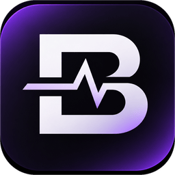
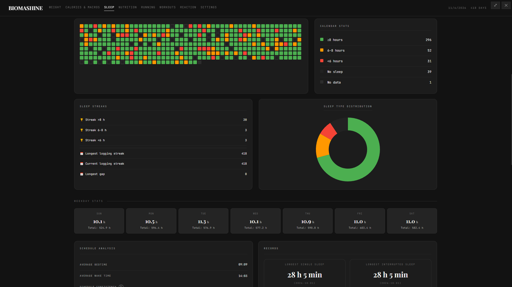

<p align="center">
  <a href="https://github.com/chetsCMD/BIOMASHINE/releases">
    
  </a>
</p>

<h1 align="center">BIOMASHINE</h1>

<p align="center">An operating environment for personal tracking</p>

<p align="center">
  <a href="README.md">English</a> / <a href="README.ru.md">Русский</a> / <a href="README.es.md">Español</a>
</p>

<p align="center">
  
  
  
  
</p>

<p align="center">
  <a href="https://github.com/chetsCMD/BIOMASHINE/releases">Download</a> ·
  <a href="https://github.com/chetsCMD/BIOMASHINE/issues">Report an issue</a> ·
  <a href="https://boosty.to/chetscmd">Support the project</a>
</p>

<p align="center">
  <a href="https://github.com/chetsCMD/BIOMASHINE/blob/main/docs/en/ROADMAP.en.md">ROADMAP</a>
</p>

---

## What BIOMASHINE is

BIOMASHINE is an operating environment for personal tracking.

Life is not limited to health. It includes physical and psychological state, finances, intellectual activity, observation of the environment — and much more. BIOMASHINE does not prescribe exactly what should be tracked or how one should live. Users choose for themselves which records they need and what meaning those records have.

Imagine a paper planner-organizer: it has a cover, a ring mechanism, paper, and dividers. You insert new sections yourself, remove unnecessary ones, rearrange pages, create your own sections, and write whatever you want in them. The organizer manufacturer does not decide for you what should be in your planner.

BIOMASHINE aims to provide the same freedom in digital form. The application provides:

- a data storage mechanism;
- a mechanism for displaying and processing data;
- a mechanism for extending the application with user modules;
- an interaction interface;
- a module management system.

And the user determines **what exactly to track**.

## The user controls the application

The main idea of BIOMASHINE is that **the person controls the program, not the program controls the person**. It is not just a ready-made set of pages to be used “as intended.” Users can shape the environment to suit themselves:

- create their own modules for the kinds of tracking they need;
- enable and hide modules, managing the composition of the application;
- create plugins and change the appearance of the interface — including developing their own themes based on the styling and plugin mechanism;
- translate the interface into any language: the application provides language files and the ability to add custom translations.

The built-in sections are only a starting point. They show how the environment is structured, but they do not limit its purpose.

## Which base pages are available

The current version includes several ready-made example pages:

- **Weight** — measurements and goals.
- **Sleep** — sleep log and schedule.
- **Nutrition** — meal records.
- **Calories & Macros** — calculation of calorie and macronutrient targets based on profile data.
- **Running** — runs, goals, and statistics.
- **Workouts** — sessions and workout templates.
- **Reaction** — reaction speed test and result history.

[](media/sleep.png)

This is not a complete list of what BIOMASHINE should be, nor a recommendation to keep exactly these records. The composition of the application can and **should** be changed and expanded to suit your own tasks.
> You can follow the project’s development and the creation of new pages in the [roadmap](https://github.com/chetsCMD/BIOMASHINE/blob/main/docs/en/ROADMAP.en.md)

# Main feature of the program
**Modular architecture**. You determine what you want to see in BIOMASHINE.

If you are a developer, [documentation](https://github.com/chetsCMD/BIOMASHINE/blob/main/.github/README.en.md#documentation-for-developers-and-extension-creators) is available for you.

But if you do not know how to work with code, that is not a problem. [Documentation for your AI agent](https://github.com/chetsCMD/BIOMASHINE/blob/main/docs/en/ai) is available. Give it the file and describe what you want to see, and it will guide you completely independently from idea to a finished module.

> [In the future](https://github.com/chetsCMD/BIOMASHINE/blob/main/docs/en/ROADMAP.en.md), it is planned to add module assembly from ready-made blocks.

## Principles

- **The user sets the rules.** The application helps collect and make sense of information, but it does not judge the person or dictate goals to them.
- **Data remains local.** BIOMASHINE works with an SQLite database on the device; a cloud account and an internet connection are not required for keeping records.
- **A personal system, not a corporate service.** This is a tool “from people to people,” created for the everyday tasks of a specific person — the user.
- **Freedom instead of a single scenario.** Ready-made pages are a foundation that the user can supplement with their own modules, themes, and translations.
- **Tracking for oneself.** Records are not needed to prove something to anyone. Their value is determined by the person themselves.

## Download

Ready-made builds are published on the [Releases](https://github.com/chetsCMD/BIOMASHINE/releases) page. The desktop version is built for Windows, Linux (AppImage), and macOS (`.zip`).

### Windows: installer and portable version

Three formats are available for Windows:

- **Installer (NSIS, `BIOMASHINE-<version>-setup.exe`)** — a standard installation for the current user. It allows choosing the installation folder and creates a desktop shortcut. **Application data is stored in `%APPDATA%\BIOMASHINE`** and is not deleted when the program is uninstalled.
- **Portable version (`.exe`)** — does not require installation. **Data is stored next to the program’s executable file**, which allows carrying the application on a flash drive.
- **ZIP archive** — contains the same files as the portable version, for manual placement.

The application does not require a cloud account. Since the database is local, when moving to another device it must be transferred separately or you must use data export in the settings.

## Running from source

Node.js version 22 or higher and npm are required.

```bash
npm install
npm start
```

Prepare a distribution for the current operating system:

```bash
npm run dist
```

You should build on the operating system for which the distribution is intended: `better-sqlite3` contains a native module. Preparation of application resources is started automatically by the `npm start` and `npm run dist` commands.

## Data and security

- In the settings, you can set a login and password to open the program. There is no way to reset the password if it is lost.
- Application data is stored locally in an SQLite database in the application data directory. In the installed Windows version — in `%APPDATA%\BIOMASHINE`; in the portable version — next to the program.
- Export to JSON and CSV is available in the settings.
- Application pages work as modules. User modules and configs are provided for by the project architecture.
- Local storage by itself is not a backup. It is recommended to periodically save the export and keep it in a safe place.

## Keyboard shortcuts

- `Ctrl+P` (on macOS — `Cmd+P`) — quick jump to a section or settings.
- `F11` — fullscreen mode.

## Documentation for developers and extension creators

- [`docs/Project Map.md`](https://github.com/chetsCMD/BIOMASHINE/blob/main/docs/en/Developers/Project%20Map.md) — project structure and map.
- [`docs/Modules.md`](https://github.com/chetsCMD/BIOMASHINE/blob/main/docs/en/Developers/Modules.md) — module architecture and internal SDK.
- [`docs/ai/`](https://github.com/chetsCMD/BIOMASHINE/tree/main/docs/en/ai) — guides and examples for modules, plugins, and configurations.

## Participation and feedback

Found a bug or want to suggest an improvement? Create an [issue](https://github.com/chetsCMD/BIOMASHINE/issues). Before submitting, check whether a similar discussion already exists.
The project has a “From people to people” philosophy, so feel free to create updates and improvements. Also: your own modules, themes, and translations into other languages.
Version `1.0.0` is a demonstrative example of what this project is, not a final version. Follow the project’s development / ideas for helping develop the project in the [ROADMAP](https://github.com/chetsCMD/BIOMASHINE/blob/main/docs/en/ROADMAP.en.md)
