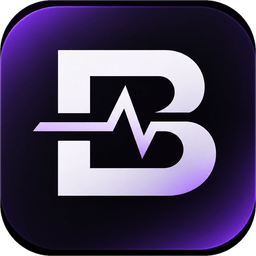
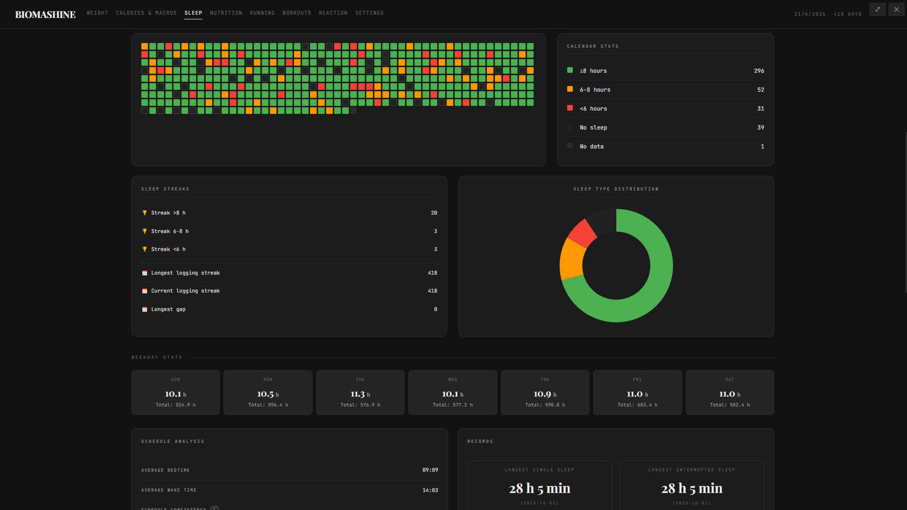
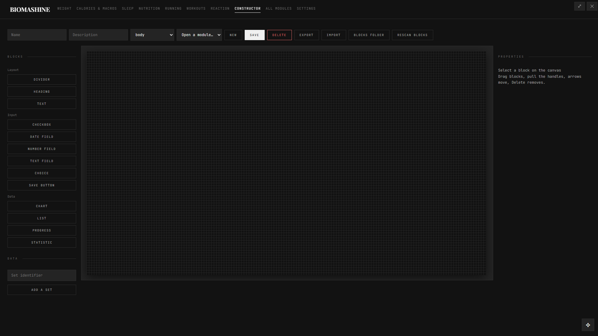

  

<h1 align="center">BIOMASHINE</h1>

An operating environment for personal tracking

  <b>English</b> / <a href="README.ru.md">Русский</a> / <a href="README.es.md">Español</a> / <a href="README.de.md">Deutsch</a>

  
  
  
  
  

  <a href="https://github.com/chetsCMD/BIOMASHINE/releases">Download</a> ·
  <a href="https://github.com/chetsCMD/BIOMASHINE/issues">Report an issue</a> ·
  <a href="https://boosty.to/chetscmd">Support the project</a>

---

## What is BIOMASHINE

BIOMASHINE is an operating environment for personal tracking.

Life is not limited to health. It includes physical and psychological state, finances, intellectual activity, observation of the environment—and much more. BIOMASHINE does not prescribe what exactly should be tracked or how one should live. Users choose which records they need and what meaning those records have.

Imagine a paper planner-organizer: it has a cover, a ring mechanism, paper, and dividers. You insert new sections yourself, remove unnecessary ones, rearrange pages, create your own, and write anything in them. The organizer manufacturer does not decide for you what should be in your diary.

BIOMASHINE aims to provide the same freedom digitally. The application provides:

- a data storage mechanism;
- a mechanism for displaying and processing that data;
- a mechanism for extending it with user modules;
- an interaction interface;
- a module management system.

And the user determines **what exactly to track**.

## Why BIOMASHINE

- **Yours.** Data never leaves the computer. No telemetry, no sync service, no registration.
- **Customizable down to the pixel.** Nothing is hardcoded: neither appearance, nor texts, nor coefficients. Language, colors, sizes, fonts, formulas, and constants are stored in settings and configuration files that can be edited inside the app or manually.
- **Modular.** Each page is a module. Hide what you don't need, add your own, or describe the page you need to an AI assistant and put the result into the modules folder.
- **Assembled without code.** The module builder assembles a page from ready-made blocks: palette, 16:9 preview, property inspector, and data editor. Custom blocks are added as a folder with a description, script, and styles.
- **Open.** Free software under the GPL license.

## The user controls the application

The main idea of BIOMASHINE is that **a person controls the program, not the program controls the person**. This is not just a ready-made set of pages to use "as intended." Users can shape the environment for themselves:

- create their own modules for the kinds of tracking they need;
- assemble pages in the builder without programming;
- enable and hide modules, controlling the application's composition;
- create plugins and change the interface appearance—including developing their own themes based on the style and plugin mechanism;
- translate the interface into any language: the app provides language files and the ability to add your own translations.

## What basic pages are available

The current version includes several ready-made example pages:

- **Weight** — measurements and goals.
- **Sleep** — sleep log and schedule.
- **Nutrition** — meal records.
- **Calories & macros** — calculation of calorie and macronutrient targets based on profile data.
- **Running** — runs, goals, and statistics.
- **Workouts** — sessions and workout templates.
- **Reaction** — reaction speed test and results history.
- **Builder** — assembling your own pages from ready-made blocks.

## Navigation

- **Panel and module hub.** Pin the modules you need most to the top panel; the rest wait in the hub: a card page with search, categories, and pin buttons. Prefer a sidebar? Switch to a vertical layout with collapsible categories.
- **Quick jump.** `Ctrl+P` (`Cmd+P` on macOS) opens any module or settings section and works on any keyboard layout.
- **Your own hotkeys.** Any shortcut can be reassigned in settings, and actions fire even when focus is inside a module page. Macros — action chains — are in beta for now.
- **Full screen.** `F11` enables it, and window controls remain within reach.
- **Session restore.** On exit, the app can offer to remember the open module, field values, and scroll position and return you to that exact screen on next launch.

# Main feature of the program
**Modular architecture**. You determine what you want to see in BIOMASHINE.

If you are a developer, [documentation](../.github/README.en.md#documentation) is available for you.

But if you don't know how to work with code, that's not a problem. There is [documentation available for your AI agent](../docs/en/ai). Give it the file and describe what you want to see, and it will guide you completely independently from idea to a finished module.

## Make it your own

- **Canvas mode.** Enable ✥ and edit any visible element: move, resize, hide, change layer. Layouts are stored separately for each module, the shell, and its screens.
- **Module builder.** Assemble a page from 13 ready-made blocks — from text and fields to charts and metrics — without a single line of code. The block set will keep growing. Custom blocks are written in a folder with a description, script, and styles.
- **Global search.** `Ctrl+O` searches records across all tables, module names and descriptions, and the content of pages you've already opened.
- **Languages.** Russian, English, Spanish, and German are built in. Export a translation template in settings, translate it, put the file in the languages folder, and your language will appear in the list.
- **Design.** Light and dark themes, and behind them a design editor: every color, size, spacing, radius, font, and animation duration is a token that can be changed for the whole app or for a single module with live preview. Write custom CSS for the whole application or an
