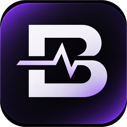
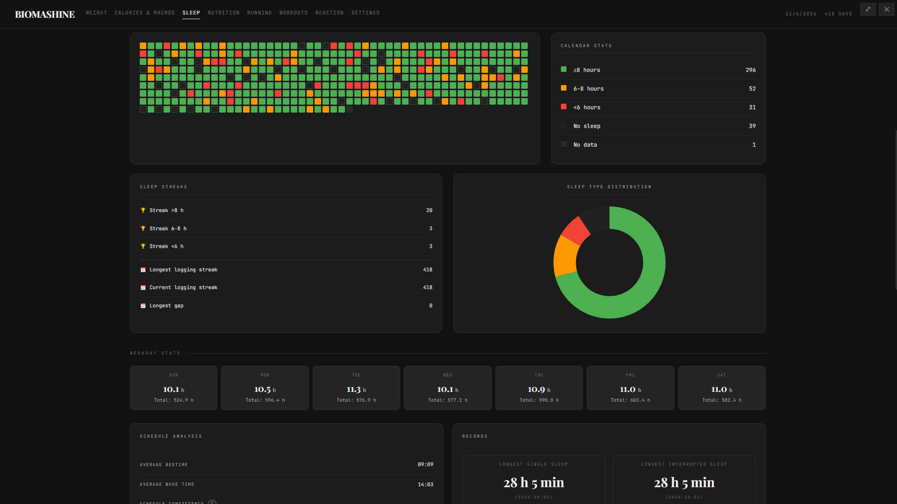

<p align="center">
  <a href="https://github.com/chetsCMD/BIOMASHINE/releases">
    
  </a>
</p>

<h1 align="center">BIOMASHINE</h1>

<p align="center">Операционная среда для персонального учёта</p>

<p align="center">
  <a href="README.md">English</a> / <b>Русский</b> / <a href="README.es.md">Español</a> / <a href="README.de.md">Deutsch</a>
</p>

<p align="center">
  
  
  
  
  <a href="https://boosty.to/chetscmd"></a>
</p>

<p align="center">
  <a href="https://github.com/chetsCMD/BIOMASHINE/releases">Скачать</a> ·
  <a href="https://github.com/chetsCMD/BIOMASHINE/issues">Сообщить о проблеме</a> ·
  <a href="https://boosty.to/chetscmd">Поддержать проект</a>
</p>

---

## Что такое BIOMASHINE

BIOMASHINE — это операционная среда для персонального учёта.

Жизнь не сводится к здоровью. Это физическое и психологическое состояние, финансы, интеллектуальная деятельность, наблюдение за окружающей средой — и многое другое. BIOMASHINE не предписывает, что именно нужно учитывать и как следует жить. Пользователь сам выбирает, какие записи ему нужны и какой смысл они имеют.

Представьте бумажный ежедневник-органайзер: у него есть обложка, кольцевой механизм, бумага и разделители. Вы сами вставляете новые разделы, убираете ненужные, переставляете страницы, создаёте собственные и записываете в них что угодно. Производитель органайзера не решает за вас, что должно быть в вашем дневнике.

BIOMASHINE стремится дать такую же свободу в цифровом виде. Приложение предоставляет:

- механизм хранения данных;
- механизм их отображения и обработки;
- механизм расширения пользовательскими модулями;
- интерфейс взаимодействия;
- систему управления модулями.

А пользователь определяет, **что именно учитывать**.

## Почему BIOMASHINE

- **Ваше.** Данные не покидают компьютер. Ни телеметрии, ни сервиса синхронизации, ни регистрации.
- **Настраивается до пикселя.** В коде не зашито ничего: ни оформление, ни тексты, ни коэффициенты. Язык, цвета, размеры, шрифты, формулы и константы лежат в настройках и конфигурационных файлах, которые можно править в самом приложении или вручную.
- **Модульное.** Каждая страница — модуль. Скрывайте ненужное, добавляйте своё или опишите нужную страницу ИИ-ассистенту и положите результат в папку модулей.
- **Открытое.** Свободное программное обеспечение под лицензией GPL.

## Пользователь управляет приложением

Главная идея BIOMASHINE — **человек управляет программой, а не программа человеком**. Это не просто готовый набор страниц, который нужно использовать «как задумано». Пользователь может формировать среду под себя:

- создавать собственные модули для нужных ему видов учёта;
- подключать и скрывать модули, управляя составом приложения;
- создавать плагины и менять внешний вид интерфейса — в том числе разрабатывать собственные темы на основе механизма стилей и плагинов;
- переводить интерфейс на любой язык: в приложении предусмотрены языковые файлы и возможность добавлять свои переводы.

## Какие базовые страницы доступны

В текущей версии есть несколько готовых примеров страниц:

- **Вес** — замеры и цели.
- **Сон** — журнал сна и расписание.
- **Питание** — записи о приёмах пищи.
- **КБЖУ** — расчёт ориентиров по калориям и макронутриентам на основе данных профиля.
- **Бег** — пробежки, цели и статистика.
- **Тренировки** — занятия и шаблоны тренировок.
- **Реакция** — тест скорости реакции и история результатов.

[](media/sleep.png)

## Навигация

- **Панель и хаб модулей.** Закрепите самые нужные модули в верхней панели, остальные ждут в хабе: странице карточек с поиском, категориями и кнопками закрепления. Больше нравится боковое меню? Переключитесь на вертикальную раскладку со сворачиваемыми категориями.
- **Быстрый переход.** `Ctrl+P` (`Cmd+P` на macOS) открывает любой модуль или раздел настроек и работает на любой раскладке клавиатуры.
- **Свои горячие клавиши.** Любое сочетание можно переназначить в настройках.
- **Полный экран.** `F11` включает его, а кнопки управления окном остаются под рукой.
- **Восстановление сессии.** При выходе приложение может предложить запомнить открытый модуль, значения полей и положение прокрутки и вернуть вас именно на этот экран при следующем запуске.

# Главная функция программы
**Модульная архитектура**. Вы сами определяете, что хотите видеть в BIOMASHINE.

Если вы разработчик, то для вас доступна [документация](../.github/README.ru.md#документация).

Но если вы не умете работать с кодом — не беда. Доступная [документация для вашего ИИ Агента](../docs/ru/ai). Отдайте ему файл и опишите, что хотите видеть, а он полностью самостоятельно проведёт вас от идеи до готового модуля.

## Сделайте под себя

- **Языки.** Встроены русский, английский, испанский и немецкий. Выгрузите шаблон перевода в настройках, переведите его, положите файл в папку языков, и ваш язык появится в списке.
- **Дизайн.** Светлая и тёмная темы, а за ними редактор дизайна: каждый цвет, размер, отступ, радиус, шрифт и время анимации это токен, который можно изменить для всего приложения или для одного модуля с живым просмотром. Пишите собственный CSS для всего приложения или отдельного модуля, импортируйте и экспортируйте готовые оформления и выстраивайте плагины в нужном порядке.
- **Редактор конфигов.** Меняйте любые JSON-конфиги (коэффициенты, цвета, пределы) прямо в приложении. Изменения применяются сразу, а хранятся только ваши отличия от значений по умолчанию.
- **Часовой пояс.** Выберите, в каком часовом поясе записываются даты и время.
- **Профили.** Держите несколько независимых пространств, например «реальная жизнь», «эксперимент» и «песочница». У каждого профиля своя база данных; создавайте, дублируйте, переименовывайте, удаляйте и переключайте их в настройках.

## Принципы

- **Пользователь задаёт правила.** Приложение помогает собирать и осмыслять информацию, но не оценивает человека и не диктует ему цели.
- **Данные остаются локальными.** BIOMASHINE работает с базой SQLite на устройстве; облачная учётная запись и подключение к интернету для ведения записей не нужны.
- **Личная система, а не корпоративный сервис.** Это инструмент «от людей к людям», создаваемый для повседневных задач конкретного человека — пользователя.
- **Свобода вместо единственного сценария.** Готовые страницы — основа, которую пользователь может дополнять собственными модулями, темами и переводами.
- **Учёт для себя.** Записи нужны не для того, чтобы что-то кому-то доказывать. Их ценность определяет сам человек.

## Ваши данные в безопасности

- **Только локально.** Одна база SQLite на профиль, никакого доступа к сети.
- **Защита паролем.** Необязательные логин и пароль, хранятся как хэш scrypt с солью.
- **Корзина.** Отмена последних десяти операций прямо из настроек.
- **Экспорт.** Сохраните всё в JSON или CSV в любой момент.
- **Уведомления.** Модули могут планировать системные уведомления, а вы можете отключить их для каждого модуля.
- **Изоляция.** Каждый модуль работает в собственном изолированном фрейме и может пользоваться только объявленными каналами.

## Скачать и установить

Свежую сборку берите на [странице релизов](https://github.com/chetsCMD/BIOMASHINE/releases).

| Система | Файл | Примечания |
|---|---|---|
| Windows | `.exe` (портативный) или `.zip` | Ничего устанавливать не нужно. Портативная версия хранит данные в папке `BIOMASHINE-data` рядом с программой, поэтому её можно носить на флешке. |
| Linux | `.AppImage` | `chmod +x` и запуск. Нужна `libfuse2`. |
| macOS | `.zip` | Без подписи: при первом запуске нажмите правой кнопкой по приложению и выберите «Открыть». |

## Сборка из исходников

Нужен Node.js 22 или новее.

```
npm install
npm start          # запустить приложение
npm run dist       # собрать для текущей операционной системы
```

Нативные модули нужно собирать на той операционной системе, для которой делается сборка. В репозитории есть рабочий процесс GitHub Actions, собирающий пакеты для Windows, Linux и macOS.

## Документация

- [Карта проекта: архитектура, каналы IPC, слой данных](../docs/ru/Developers/Project%20Map.md)
- [Модули: манифест, SDK, хранилище, оформление](../docs/ru/Developers/Modules.md)
- [Дизайн-система: токены, инструмент, редактор](../docs/ru/Developers/Design.md)
- [Руководство для ИИ-ассистентов: создание модуля](../docs/ru/ai/MODULE_GUIDE.md)
- [Руководство для ИИ-ассистентов: создание плагина](../docs/ru/ai/PLUGIN_GUIDE.md)

## Поддержать проект

BIOMASHINE бесплатен и создаётся одним человеком. Если он вам полезен, можно [поддержать автора](https://boosty.to/chetscmd) или поставить репозиторию звезду.

## Лицензия

BIOMASHINE — свободное программное обеспечение под лицензией GNU General Public License v3.0 с дополнительным условием об указании авторства (раздел 7b). Полный текст в файле `LICENSE`.
