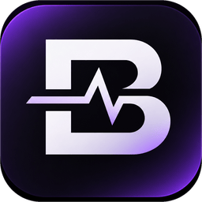
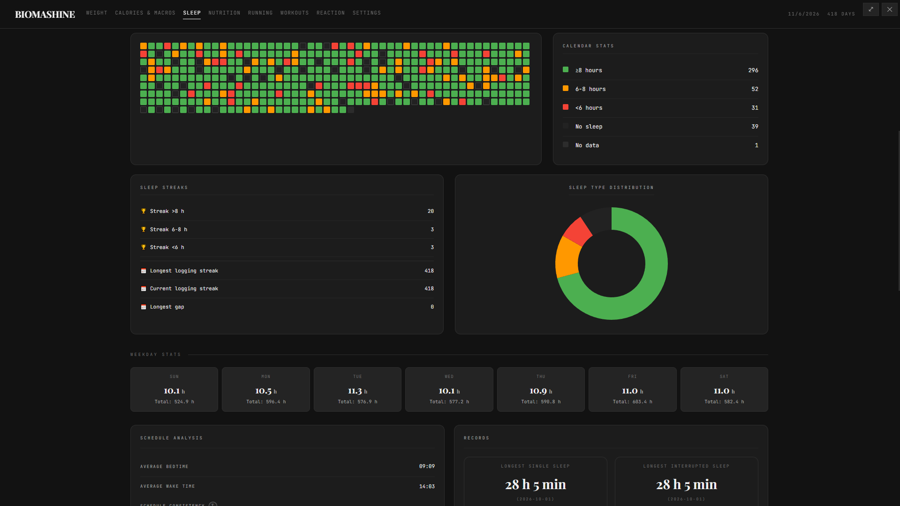

<p align="center">
  <a href="https://github.com/chetsCMD/BIOMASHINE/releases">
    
  </a>
</p>

<h1 align="center">BIOMASHINE</h1>

<p align="center">Операционная среда для персонального учёта</p>

<p align="center">
  <a href="README.md">English</a> / <a href="README.ru.md">Русский</a>
</p>

<p align="center">
  
  
  
  
</p>

<p align="center">
  <a href="https://github.com/chetsCMD/BIOMASHINE/releases">Скачать</a> ·
  <a href="https://github.com/chetsCMD/BIOMASHINE/issues">Сообщить о проблеме</a> ·
    <a href="https://boosty.to/chetscmd">Поддержать проект</a>
</p>

<p align="center">
  <a href="https://github.com/chetsCMD/BIOMASHINE/blob/main/docs/ru/ROADMAP.ru.md">ROADMAP</a>
</p>

---

## Что такое BIOMASHINE

BIOMASHINE — это операционная среда для персонального учёта.

Жизнь не сводится к здоровью. Это физическое и психологическое состояние, финансы, интеллектуальная деятельность, наблюдение за окружающей средой — и многое другое. BIOMASHINE не предписывает, что именно нужно учитывать и как следует жить. Пользователь сам выбирает, какие записи ему нужны и какой смысл они имеют.

Представьте бумажный ежедневник-органайзер: у него есть обложка, кольцевой механизм, бумага и разделители. Вы сами вставляете новые разделы, убираете ненужные, переставляете страницы, создаёте собственные и записываете в них что угодно. Производитель органайзера не решает за вас, что должно быть в вашем дневнике.

BIOMASHINE стремится дать такую же свободу в цифровом виде. Приложение предоставляет:

- механизм хранения данных;
- механизм их отображения и обработки;
- механизм расширения пользовательскими модулями;
- интерфейс взаимодействия;
- систему управления модулями.

А пользователь определяет, **что именно учитывать**.

## Пользователь управляет приложением

Главная идея BIOMASHINE — **человек управляет программой, а не программа человеком**. Это не просто готовый набор страниц, который нужно использовать «как задумано». Пользователь может формировать среду под себя:

- создавать собственные модули для нужных ему видов учёта;
- подключать и скрывать модули, управляя составом приложения;
- создавать плагины и менять внешний вид интерфейса — в том числе разрабатывать собственные темы на основе механизма стилей и плагинов;
- переводить интерфейс на любой язык: в приложении предусмотрены языковые файлы и возможность добавлять свои переводы.

Встроенные разделы — лишь отправная точка. Они показывают, как устроена среда, но не ограничивают её назначение. 

## Какие базовые страницы доступны

В текущей версии есть несколько готовых примеров страниц:

- **Вес** — замеры и цели.
- **Сон** — журнал сна и расписание.
- **Питание** — записи о приёмах пищи.
- **КБЖУ** — расчёт ориентиров по калориям и макронутриентам на основе данных профиля.
- **Бег** — пробежки, цели и статистика.
- **Тренировки** — занятия и шаблоны тренировок.
- **Реакция** — тест скорости реакции и история результатов.

[](media/sleep.png)

Это не полный список того, чем должна быть BIOMASHINE, и не рекомендация вести именно такие записи. Состав приложения можно и **нужно** менять и расширять под свои задачи.
> Следить за развитием проекта и созданием новых страниц можно в [дорожной карте](https://github.com/chetsCMD/BIOMASHINE/blob/main/docs/ru/ROADMAP.ru.md)

# Главная функция программы
**Модульная архитектура**. Вы сами определяете, что хотите видеть в BIOMASHINE.

Если вы разработчик, то для вас доступна [документация](https://github.com/chetsCMD/BIOMASHINE/blob/main/.github/README.ru.md#документация-для-разработчиков-и-создателей-расширений).

Но если вы не умете работать с кодом — не беда. Доступная [документация для вашего ИИ Агента](https://github.com/chetsCMD/BIOMASHINE/blob/main/docs/ru/ai). Отдайте ему файл и опишите, что хотите видеть, а он полностью самостоятельно проведёт вас от идеи до готового модуля.

> [В будущем](https://github.com/chetsCMD/BIOMASHINE/blob/main/docs/ru/ROADMAP.ru.md) планируется добавить сборку модулей из готовых блоков.

## Принципы

- **Пользователь задаёт правила.** Приложение помогает собирать и осмыслять информацию, но не оценивает человека и не диктует ему цели.
- **Данные остаются локальными.** BIOMASHINE работает с базой SQLite на устройстве; облачная учётная запись и подключение к интернету для ведения записей не нужны.
- **Личная система, а не корпоративный сервис.** Это инструмент «от людей к людям», создаваемый для повседневных задач конкретного человека — пользователя.
- **Свобода вместо единственного сценария.** Готовые страницы — основа, которую пользователь может дополнять собственными модулями, темами и переводами.
- **Учёт для себя.** Записи нужны не для того, чтобы что-то кому-то доказывать. Их ценность определяет сам человек.

## Загрузка

Готовые сборки публикуются на странице [Релизы](https://github.com/chetsCMD/BIOMASHINE/releases). Форматы сборок зависят от релиза и платформы. Настольная версия собирается для Windows (portable `.exe` и `.zip`), Linux (AppImage) и macOS (`.zip`).

Приложение не требует облачной учётной записи. Поскольку база находится локально, при переносе на другое устройство её нужно перенести отдельно или воспользоваться экспортом данных в настройках.

## Запуск из исходников

Нужны Node.js версии 22 или выше и npm.

```bash
npm install
npm start
```

Подготовить дистрибутив для текущей операционной системы:

```bash
npm run dist
```

Собирать следует на той операционной системе, для которой предназначен дистрибутив: `better-sqlite3` содержит нативный модуль. Подготовка ресурсов приложения запускается автоматически командами `npm start` и `npm run dist`.

## Данные и безопасность

- В настройках можно задать логин и пароль для открытия программы. Возможности сброса пароля при его потери нет.
- Данные приложения хранятся локально в базе SQLite в каталоге данных приложения. В портативных сборках расположение зависит от режима запуска.
- В настройках доступны экспорт в JSON и CSV.
- Страницы приложения работают как модули. Пользовательские модули и конфиги предусмотрены архитектурой проекта.
- Локальное хранение само по себе не является резервным копированием. Рекомендуется периодически сохранять экспорт и хранить его в безопасном месте.

## Горячие клавиши

- `Ctrl+P` (на macOS — `Cmd+P`) — быстрый переход к разделу или настройкам.
- `F11` — полноэкранный режим.

## Документация для разработчиков и создателей расширений

- [`docs/Project Map.md`](https://github.com/chetsCMD/BIOMASHINE/blob/main/docs/en/Developers/Project%20Map.md) — устройство и карта проекта.
- [`docs/Modules.md`](https://github.com/chetsCMD/BIOMASHINE/blob/main/docs/en/Developers/Modules.md) — архитектура модулей и внутренний SDK.
- [`docs/ai/`](https://github.com/chetsCMD/BIOMASHINE/tree/main/docs/ru/ai) — руководства и примеры для модулей, плагинов и конфигураций.

## Участие и обратная связь

Нашли ошибку или хотите предложить улучшение? Создайте [issue](https://github.com/chetsCMD/BIOMASHINE/issues). Перед отправкой проверьте, нет ли уже похожего обсуждения. 
Проект имеет философию «От людей к людям», так что свободно создавайте обновления, улучшения. А также: свои модули, темы, перевод на другие языки.
Версия `1.0.0` является показательным примером того, что это за проект, а не финальной версией. За развитием проекта/за идеями для помощи развития проекта следите в [ROADMAP](https://github.com/chetsCMD/BIOMASHINE/blob/main/docs/ru/ROADMAP.ru.md)
